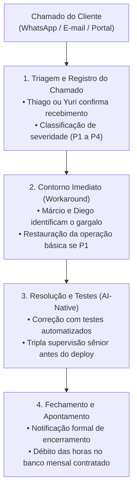

# PROTOCOLO DE GESTÃO DE INCIDENTES E MATRIZ DE SLA

Este documento define o procedimento padrão para abertura, triagem, resolução e encerramento de chamados técnicos de sustentação para os clientes da empresa.

---

## 1. Classificação de Severidade dos Incidentes

| Nível | Classificação | Impacto no Negócio do Cliente | Exemplo Real | Tempo de Resposta | Início da Atuação |
| :---: | :--- | :--- | :--- | :---: | :---: |
| **P1** | **Crítico / Emergência** | Sistema completamente fora do ar, interrupção de faturamento ou risco iminente de perda de dados. | Aplicação não abre, banco de dados travado, falha na emissão de notas fiscais ou gateway de pagamento fora. | **Até 2h** | **Imediato** |
| **P2** | **Alto** | Funcionalidade central inoperante sem método de contorno fácil, afetando múltiplos usuários. | Módulo de relatórios de fechamento diário falhando, representantes sem conseguir salvar pedidos. | **Até 4h** | **Até 6h** |
| **P3** | **Médio** | Funcionalidade secundária com falha, lentidão pontual ou problema com plano de contorno disponível. | Erro visual em tela de cadastro secundária, lentidão em consulta pontual. | **Até 8h** | **Até 24h** |
| **P4** | **Baixo / Evolutivo** | Dúvidas operacionais, pequenas melhorias cosméticas ou novas regras de negócio para o backlog. | Ajuste de texto em botão, adição de novo campo em formulário, pequenas melhorias. | **Até 12h** | **No Backlog** |

---

## 2. Fluxo Operacional de Atendimento (Passo a Passo)

---

## 3. Divisão de Papéis durante um Incidente Crítico (P1)

* **Thiago:** Assume a **Comunicação com o Cliente**. Alinha expectativas, tranquiliza o diretor da empresa e fornece atualizações de status a cada 30 a 60 minutos até o restabelecimento do serviço.
* **Diego:** Lidera o **Diagnóstico de Arquitetura e Causa Raiz** (inspeção de logs de servidor, locks de banco de dados SQL e estabilidade da nuvem).
* **Márcio e Yuri:** Executam o **Patch de Código / Hotfix**, geram os testes de regressão e realizam o deploy seguro em produção.

---

## 4. Política de Transparência e "Post-Mortem"

Após a resolução de qualquer incidente de nível P1 ou P2 reincidente, a empresa entrega em até 48 horas um documento de **Post-Mortem Técnico** contendo:
1. **O que aconteceu:** Descrição clara da falha;
2. **Tempo total de indisponibilidade:** Duração do impacto;
3. **Causa raiz identificada:** O motivo técnico do problema;
4. **Ação corretiva preventiva:** O que foi implementado no código ou infraestrutura para garantir que a mesma falha nunca mais se repita.

> *Essa postura profissional e transparente é o que transforma clientes pontuais em contratos de manutenção que duram anos.*
